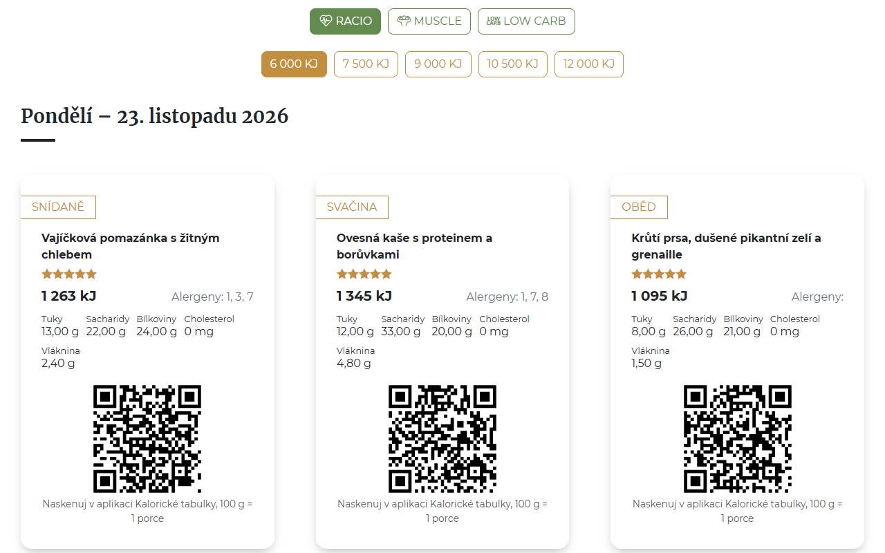

# FF Menu do Kalorických tabulek

Doplněk pro Chrome, který na jídelníčku [ffmenu.cz](https://www.ffmenu.cz/jidelnicek) ukáže u každého jídla QR kód. Když ho naskenuješ v aplikaci [Kalorické tabulky](https://www.kaloricketabulky.cz), otevře se jídlo s energií a makry z jídelníčku a přidáš ho do deníku.



English version: [README.md](README.md). Projekt nemá nic společného s FF Menu (BeraTaste s.r.o.) ani s Kalorickými tabulkami (Dine4Fit, a.s.).

## Co umí

- U každého jídla na ffmenu.cz/jidelnicek je tlačítko „Zobrazit QR pro Kalorické tabulky“. Ukáže QR kód, který čtečka v aplikaci Kalorické tabulky otevře jako potravinu.
- K energii v kJ doplní kcal. Dělí stejně jako aplikace, číslem 4,1871.
- Doplněk nechce žádné přihlášení a nic si neukládá. Serveru pošle jen klíč jídla: program, den a pořadí na jídelníčku.
- Potraviny zakládá malý server v Pythonu pod jedním společným účtem. Každé jídlo založí jednou a všichni pak skenují stejnou potravinu.
- Energii, bílkoviny, sacharidy, tuky, vlákninu a cholesterol si server čte přímo z jídelníčku ffmenu.cz. Nic neodhaduje.
- Volitelně zapíše celý den do tvého vlastního deníku, z příkazové řádky nebo ze stránky pro mobil, která umí přečíst i štítek z krabičky.

## Instalace

Chrome na Windows a macOS instaluje doplňky mimo Chrome Web Store jen v režimu pro vývojáře. Než bude doplněk v obchodě, instaluje se takhle:

1. Stáhni repozitář a sestav balíček: `git clone https://github.com/nks-hub/ffmenu-kaloricky.git`, pak v jeho složce `python tools/build_extension.py`. Vznikne `dist/ffmenu-kt-<verze>.zip`.
2. Zip rozbal do složky, kterou nebudeš mazat. Chrome z ní doplněk načítá při každém spuštění.
3. V Chrome otevři `chrome://extensions`, zapni Režim pro vývojáře, klikni na „Načíst rozbalené“ a vyber tu složku.

Novou verzi rozbal přes stejnou složku a v `chrome://extensions` u doplňku klikni na šipku pro obnovení.

Stejný zip se nahrává do Chrome Web Store. Texty zápisu, odpovědi k ochraně soukromí a obrázky jsou v [store/listing.md](store/listing.md).

Doplněk načte i Firefox 121 a novější. Část na stránce jídelníčku jsem zkoušel ve Firefoxu 160.

## Použití

1. Otevři [ffmenu.cz/jidelnicek](https://www.ffmenu.cz/jidelnicek) a vyber svůj program.
2. Pod jídlem klikni na „Zobrazit QR pro Kalorické tabulky“.
3. V aplikaci Kalorické tabulky klepni na „Čárový kód“ a namiř fotoaparát na kód.
4. Otevřenou potravinu přidej. Jmenuje se `FF Menu: <jídlo> (<energie porce> kJ)`. Jednu porci zadej jako 100 g, protože FF Menu váhu porce neuvádí.

## Jak to funguje

Kalorické tabulky veřejné API nemají. Všechno níž pochází z jejich aplikace pro Android 3.14.71.

Čtečka v aplikaci bere QR kód, který začíná `https://dine4fit.com/food/`, jako ID potraviny a tu otevře. Hodnoty živin z kódu přečíst neumí, takže jídlo musí v Kalorických tabulkách nejdřív existovat jako potravina. Jedno kliknutí proběhne takhle:

1. Doplněk z karty jídla sestaví klíč, třeba `1:2026-11-23:1` pro program 1, 23. 11. 2026 a druhé jídlo dne. Klíč pošle na `GET https://ffkt.nks-hub.cz/api/food?key=...`. Nic jiného z prohlížeče neodchází.
2. Server si ten týden načte z ffmenu.cz sám, takže mu nikdo nepodstrčí vymyšlené hodnoty. Přijme jen týdny, které ffmenu.cz ukazuje: minulý, tento a příští.
3. Server se zeptá kontroly duplicit, kterou používá aplikace (`POST api/v1/food-suggestion/search/duplicates` s hodnotami na 100 g), jestli jeho účet jídlo už má. Když ne, založí ho stejně jako „Přidat novou potravinu“ v aplikaci: `POST api/v1/food-suggestion/foodstuff` s hodnotami na 100 g, kategorií 1026 (Hotové pokrmy a polotovary) a třemi fotkami, které aplikace vyžaduje. Krabičky FF Menu nutriční tabulku nemají, proto je fotkou vygenerovaná karta s hodnotami z jídelníčku a se zdrojem. Cukry a sůl jsou povinné a FF Menu je neuvádí, posílají se tedy jako 0.
4. Server si ID potraviny zapamatuje v `data/foods.json` a vrátí `https://dine4fit.com/food/<id>`. Doplněk z toho nakreslí QR kód přibalenou knihovnou [qrcode.js](extension/lib/qrcode.js).

Server je tu proto, že kontrola duplicit vidí jen potraviny přihlášeného účtu. Kdyby se každý přihlásil svým účtem, každý by si založil vlastní kopii každého jídla. Heslo zabudované do doplňku řešení není, přečetl by ho každý, kdo si doplněk nainstaluje. Jeden společný účet na serveru založí každé jídlo jednou a hesla v prohlížeči nejsou.

Co server ukládá a co se loguje, popisuje [PRIVACY.md](PRIVACY.md).

## Vlastní server

`python -m ffkt serve` odpovídá na `GET /api/food?key=<program>:<RRRR-MM-DD>:<pořadí>` odkazem pro QR kód. Tahle cesta token nechce. Zápis do deníku ze stránky pro mobil token chce.

V Dockeru: vedle `docker-compose.yml` založ `.env` s účtem:

```
FFKT_KT_EMAIL=ty@example.com
FFKT_KT_PASSWORD=...
FFKT_TOKEN=...        # volitelné; bez něj dostane deník náhodný token, vypíše se do logu
FFKT_PORT=8077        # volitelné
```

```
docker compose up -d --build
```

Doplněk potřebuje HTTPS. Server proto dej za reverzní proxy s certifikátem a jeho adresu zapiš do `SERVER_URL` v `extension/background.js` a do `host_permissions` v `extension/manifest.json`. Docker obraz stránku pro mobil nemá: zapisovala by do deníku účtu serveru, takže patří do lokální instalace s tvým vlastním účtem.

## Celý den do vlastního deníku (volitelné)

QR kód přidá jedno jídlo, a to do deníku toho, kdo ho naskenuje. Celý den naráz musí zapsat tvůj vlastní účet, protože Kalorické tabulky pustí účet zapisovat jen do jeho deníku. Tahle část běží na tvém počítači s tvým přihlášením:

```
python -m ffkt setup                    # přihlášení do KT a tvůj program
python -m ffkt add-day                  # zapíše dnešní jídla
python -m ffkt menu --date 2026-11-24   # vypíše jídelníček dne
python -m ffkt serve                    # stránka pro mobil na portu 8077
```

`setup` uloží přihlášení, program a přístupový token do `config.local.json`. Je v něm MD5 hash hesla a ten k přihlášení do KT stačí. Soubor je v `.gitignore`, nikam ho neposílej.

`add-day` zapíše každé jídlo do jeho části dne (snídaně, svačiny, oběd, večeře) jako vlastní záznam s hodnotami z jídelníčku, přes `addPrijem.php` (`Typ: vlozenaHodnota`). Co už zapsal, příště přeskočí. Každý všední den ráno to za tebe udělá Plánovač úloh ve Windows:

```
schtasks /Create /TN "FF Menu do KT" /SC WEEKLY /D MON,TUE,WED,THU,FRI /ST 06:30 /TR "cmd /c cd /d C:\cesta\k\ffmenu-kaloricky && python -m ffkt add-day"
```

Stránka pro mobil umí totéž z telefonu. Na počítači otevři `http://127.0.0.1:8077`, rozbal „Otevřít v mobilu (QR)“ a QR naskenuj fotoaparátem. Mobil musí být ve stejné síti. „Zapsat celý den“ zapíše den. „Vyfotit štítek“ přečte štítek z krabičky (OCR přes Tesseract.js) a nabídne jídlo; na Galaxy S21 s Chrome 157 trval jeden sken 7 až 8 sekund. QR kód na štítku vede jen na úvodní stránku ffmenu.cz, proto stránka čte text štítku. Stejné jídlo má v každém programu jinou porci, a tak program pozná podle maker na štítku.

## Omezení

- Bez serveru doplněk nefunguje. Když server neběží, ukáže u jídla „server doplňku není dostupný“.
- Potraviny od serveru čekají na schválení v Kalorických tabulkách. Do té doby je jiné účty ve vyhledávání nenajdou, otevřou je jen přes QR kód.
- Rozhraní Kalorických tabulek je neoficiální. Když ho změní, zakládání potravin selže a doplněk ukáže chybu, kterou KT vrátily.
- Potraviny jsou v databázi Kalorických tabulek veřejné a mají cukry a sůl 0.
- Jednotku „porce“ Kalorické tabulky u nové potraviny ignorují (zkoušeno se 100 g i 300 g) a potravinu do schválení moderátorem zamknou, takže jedna porce FF Menu se zadává jako 100 g.
- Jídelníček na další týden zveřejňuje FF Menu až během týdne. Do té doby pro něj QR kódy nejsou.

## Testy

```
python -m unittest discover -s tests
FFKT_E2E=1 python -m unittest discover -s tests -p test_e2e.py   # v prohlížeči, potřebuje Playwright
```

Tyhle testy se ke Kalorickým tabulkám nepřipojují, nahrazuje je lokální server `tests/fake_kt.py`. V prohlížečových testech Chromium posílá ffkt.nks-hub.cz na lokální server s testovacím certifikátem z `tests/fixtures/tls`.

Živé testy pouštějí server i doplněk proti skutečným Kalorickým tabulkám a živému jídelníčku ffmenu.cz. Zapíšou jídla jednoho dne do účtu, přečtou je zpátky přes rozhraní, ze kterého aplikace KT kreslí deník, a zase je smažou. Pouštěj je jen s testovacím účtem:

```
FFKT_LIVE=1 FFKT_KT_EMAIL=... FFKT_KT_PASSWORD=... python -m unittest discover -s tests -p test_live.py
```

## Licence

MIT, viz [LICENSE](LICENSE).
