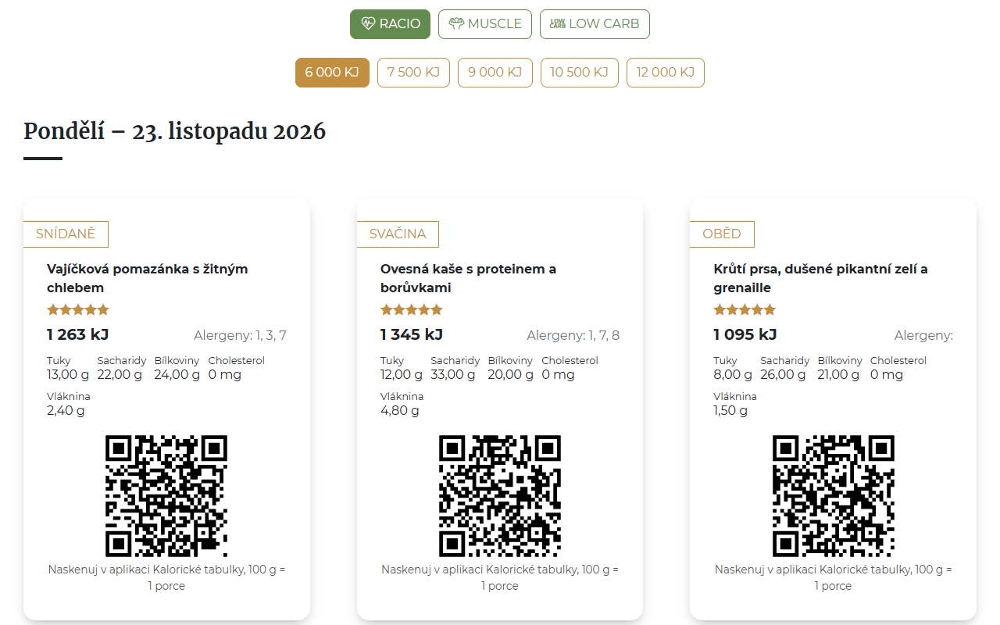

# FF Menu to Kalorické tabulky

[](LICENSE)
[](extension/manifest.json)
[](ffkt)

> Chrome extension that adds a QR code to every meal of the [ffmenu.cz](https://www.ffmenu.cz/jidelnicek) weekly menu. Scan it with the [Kalorické tabulky](https://www.kaloricketabulky.cz) app and the meal opens with the energy and macros from the menu, ready to be added to your diary.



Česká verze: [README.cs.md](README.cs.md). Not affiliated with FF Menu (BeraTaste s.r.o.) or Kalorické tabulky (Dine4Fit, a.s.).

## Features

- 📱 **QR code per meal** - a "Zobrazit QR pro Kalorické tabulky" button below every meal card shows a code that the barcode scanner of the Kalorické tabulky app opens as a food
- 🔥 **kcal next to kJ** - the menu lists only kJ; the extension adds kcal, divided by 4.1871 like the app does
- 🔐 **No login** - the extension sends only the meal key (program, day, position on the menu) and stores nothing
- 🔁 **One food per dish** - a small Python server creates each dish once under a shared account, so everyone scans the same food instead of making a private copy
- ⚖️ **Values from the menu** - energy, protein, carbohydrates, fat, fiber and cholesterol come from the ffmenu.cz page, nothing is estimated
- 🗓️ **Whole day into your own diary** - an optional command and phone page log a day of meals, or a scanned box label, into your own Kalorické tabulky account

## Requirements

- Chrome, Edge or another Chromium browser. Firefox 121+ loads the extension as well; its menu-page part was checked in Firefox 160.
- Your own server (optional): Docker, or Python 3.12 with Pillow, and a Kalorické tabulky account that signs in with email and password.
- Whole-day logging and the label scanner (optional): Python 3.12 without third-party packages, and your own Kalorické tabulky account.

## Installation

Chrome on Windows and macOS installs extensions from outside the Chrome Web Store only in Developer mode, so until the extension is in the store. The built zip of every version is attached to its [GitHub release](https://github.com/nks-hub/ffmenu-kaloricky/releases); download it there, or build it yourself:

```
git clone https://github.com/nks-hub/ffmenu-kaloricky.git
cd ffmenu-kaloricky
python tools/build_extension.py   # writes dist/ffmenu-kt-<version>.zip
```

1. Unzip `dist/ffmenu-kt-<version>.zip` into a folder you keep (Chrome loads the extension from it on every start).
2. Open `chrome://extensions`, turn on Developer mode, click "Load unpacked" and pick that folder.

For a new version, unzip it over the same folder and press the reload arrow of the extension in `chrome://extensions`.

The same zip is the upload for the Chrome Web Store; the listing texts, privacy answers and graphics are in [store/listing.md](store/listing.md).

## Usage

1. Open [ffmenu.cz/jidelnicek](https://www.ffmenu.cz/jidelnicek) and pick your program.
2. Click "Zobrazit QR pro Kalorické tabulky" below a meal.
3. In the Kalorické tabulky app tap "Čárový kód" and point the camera at the code.
4. Add the food that opens. It is named `FF Menu: <meal> (<portion energy> kJ)`. Enter one portion as 100 g, because FF Menu does not publish the weight of a portion.

## How it works

Kalorické tabulky has no public API. Everything below comes from its Android app 3.14.71.

The scanner of the app treats a QR code that starts with `https://dine4fit.com/food/` as the ID of a food and opens that food. It cannot take nutrition values from the code, so every meal has to exist in Kalorické tabulky as a food before it can have a QR code. One click goes like this:

1. The extension reads the meal card and builds its key, for example `1:2026-11-23:1` for program 1, 23 November 2026, the second meal of the day. It sends the key to `GET https://ffkt.nks-hub.cz/api/food?key=...`. Nothing else leaves the browser.
2. The server loads that menu week from ffmenu.cz itself, so a request cannot make it create a food with made-up values. It accepts only the weeks ffmenu.cz shows: last, this and next.
3. The server asks the duplicate check of the app (`POST api/v1/food-suggestion/search/duplicates`, values per 100 g) whether its account has the dish already. If not, it creates the food the way "Přidat novou potravinu" in the app does: `POST api/v1/food-suggestion/foodstuff` with the values per 100 g, category 1026 (Hotové pokrmy a polotovary) and the three photos the app requires. FF Menu boxes have no nutrition table, so the photo is a generated card with the menu values and their source. Sugar and salt are required fields that FF Menu does not publish, so they are 0.
4. The server keeps the food ID in `data/foods.json` and answers `https://dine4fit.com/food/<id>`. The extension draws the QR code with the bundled [qrcode.js](extension/lib/qrcode.js).

The server exists because the duplicate check sees only the foods of the signed-in account. If every user signed in with their own account, each of them would create a private copy of every dish. A password built into the extension is no answer either: anyone who installs it could read it. One shared account on the server creates each dish once and keeps passwords out of the browser.

What the server stores and logs is described in [PRIVACY.md](PRIVACY.md).

## Running your own server

`python -m ffkt serve` answers `GET /api/food?key=<program>:<YYYY-MM-DD>:<position>` with the QR link of the meal. The route needs no token. The diary routes of the phone page need the token.

With Docker, put the account into `.env` next to `docker-compose.yml`:

```
FFKT_KT_EMAIL=you@example.com
FFKT_KT_PASSWORD=...
FFKT_TOKEN=...        # optional; without it the diary routes get a random token, printed in the log
FFKT_PORT=8077        # optional
```

```
docker compose up -d --build
```

The extension needs HTTPS, so put the server behind a reverse proxy with a certificate and change `SERVER_URL` in `extension/background.js` and `host_permissions` in `extension/manifest.json` to its address. The Docker image leaves out the phone page: that page writes into the diary of the server's account, so it belongs to a local install with your own account.

## Whole day into your own diary (optional)

A QR code adds one meal, into the diary of whoever scans it. Logging a whole day at once has to be done by your own account, because Kalorické tabulky lets an account write only into its own diary. This part runs on your computer with your login:

```
python -m ffkt setup                    # Kalorické tabulky login and your program
python -m ffkt add-day                  # log today's meals
python -m ffkt menu --date 2026-11-24   # print a day's menu
python -m ffkt serve                    # phone page on port 8077
```

`setup` saves the login, your program and an access token to `config.local.json`. The file holds the MD5 hash of your password, which is enough to log in to Kalorické tabulky; it is git-ignored, keep it private.

`add-day` writes every meal into its part of the day (breakfast, snacks, lunch, dinner) as a custom entry with the values from the menu, through `addPrijem.php` (`Typ: vlozenaHodnota`). Meals it has already written are skipped. To log every weekday automatically on Windows:

```
schtasks /Create /TN "FF Menu do KT" /SC WEEKLY /D MON,TUE,WED,THU,FRI /ST 06:30 /TR "cmd /c cd /d C:\path\to\ffmenu-kaloricky && python -m ffkt add-day"
```

The phone page does the same from the phone. Open `http://127.0.0.1:8077` on the computer, expand "Otevřít v mobilu (QR)" and scan the code with the phone camera; the phone has to be on the same network. "Zapsat celý den" logs the day. "Vyfotit štítek" reads the box label with OCR (Tesseract.js) and offers the matching meal; on a Galaxy S21 with Chrome 157 one scan took 7 to 8 seconds. The QR code printed on the label only links to the ffmenu.cz home page, which is why the page reads the label text. The same dish has a different portion in each program, so the macros on the label tell the programs apart.

## Limitations

- The extension works only while the server is up. Without it the meal card shows "server doplňku není dostupný".
- Foods the server creates wait for approval by Kalorické tabulky. Until then other accounts cannot find them in search, only open them from the QR code.
- The Kalorické tabulky API is unofficial. If it changes, creating foods fails and the extension shows the error returned by Kalorické tabulky.
- Foods are public in the Kalorické tabulky database and show sugar and salt as 0.
- Kalorické tabulky ignores the portion unit of a new food (tried with "porce" at 100 g and 300 g) and keeps the food locked until its moderators approve it, so one FF Menu portion is entered as 100 g.
- FF Menu publishes the next week's menu during the week. Until then there are no QR codes for it.

## Testing

```
python -m unittest discover -s tests
```

Browser tests run the extension on the menu page, decode its QR codes from screenshots, and run the phone page OCR on two real label photos. They need Playwright, Chromium, zxing-cpp, Pillow and internet access:

```
pip install playwright zxing-cpp pillow
python -m playwright install chromium
FFKT_E2E=1 python -m unittest discover -s tests -p test_e2e.py
```

These tests never contact Kalorické tabulky. `tests/fake_kt.py` stands in for it, and in browser tests Chromium resolves ffkt.nks-hub.cz to a local server that uses the self-signed test certificate in `tests/fixtures/tls`.

Live tests run the server and the extension against the real Kalorické tabulky and the live ffmenu.cz menu. They write a day of meals into the account, read the entries back through the API the Kalorické tabulky app uses for its diary screen, and delete them again. Use a throwaway account:

```
FFKT_LIVE=1 FFKT_KT_EMAIL=... FFKT_KT_PASSWORD=... python -m unittest discover -s tests -p test_live.py
```

## Contributing

1. Fork the repository
2. Create a feature branch (`git checkout -b feat/my-change`)
3. Commit your changes (`git commit -m "feat: add my change"`)
4. Push to the branch (`git push origin feat/my-change`)
5. Open a Pull Request

## Support

- 📧 **Email:** dev@nks-hub.cz
- 🐛 **Bug reports:** [GitHub Issues](https://github.com/nks-hub/ffmenu-kaloricky/issues)

## License

MIT License — see [LICENSE](LICENSE) for details.

---

<p align="center">Made with ❤️ by <a href="https://github.com/nks-hub">NKS Hub</a></p>
